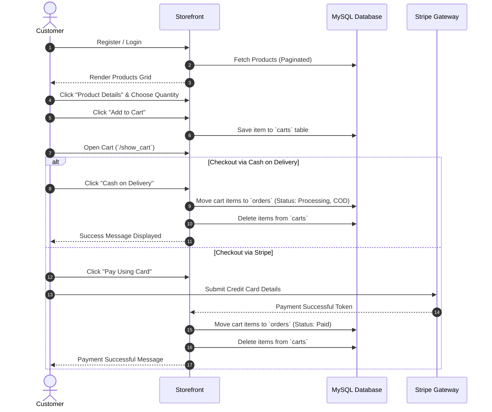
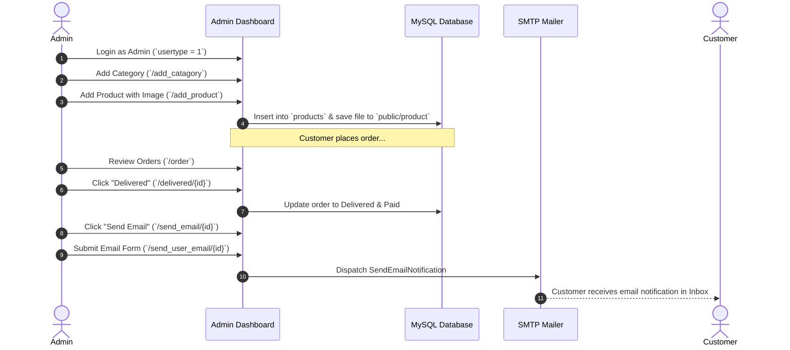
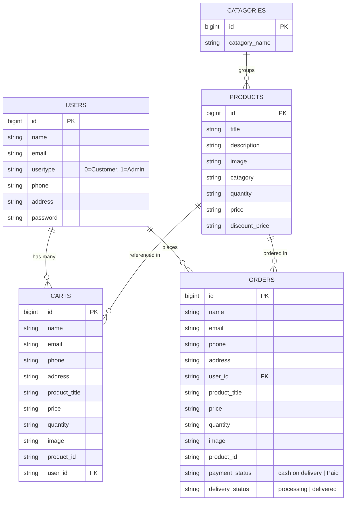

# E-Commerce Platform - Comprehensive Documentation & System Workflow

A complete architectural and feature documentation guide for the **Laravel E-Commerce Platform**, detailing all customer features, administrative management capabilities, database structures, and end-to-end operational flows.

---

## 📑 Table of Contents
1. [System Overview & Architecture](#-system-overview--architecture)
2. [User Roles & Access Control](#-user-roles--access-control)
3. [Customer / User Features](#-customer--user-features)
4. [Admin Management Features](#-admin-management-features)
5. [End-to-End System Workflows](#-end-to-end-system-workflows)
6. [Database Schema & Models](#-database-schema--models)
7. [Complete Route & Controller Matrix](#-complete-route--controller-matrix)
8. [Setup, Environment & Testing Guide](#-setup-environment--testing-guide)

---

## 🏛️ System Overview & Architecture

The application is built on **Laravel 12** utilizing MVC (Model-View-Controller) architecture, styled with **Tailwind CSS**, bundled using **Vite**, and backed by **MySQL**.

### Technology Stack
* **Backend:** PHP 8.2+ / Laravel 12
* **Frontend:** Blade Templates, Tailwind CSS, Vite, Livewire 3
* **Authentication:** Laravel Jetstream & Sanctum
* **Database:** MySQL 8.0
* **Payment Processing:** Stripe API PHP SDK
* **Notifications:** Laravel Mail & Notification System
* **Asset Storage:** Public local disk (`public/product` & `public/storage`)

---

## 👥 User Roles & Access Control

Access control is governed by the `usertype` attribute in the `users` database table:

| Role | `usertype` Value | Default Landing URL | Capabilities |
| :--- | :---: | :--- | :--- |
| **Customer (User)** | `0` | `/` (Storefront) | Browse catalog, view product details, manage shopping cart, checkout via COD or Stripe, update profile. |
| **Administrator** | `1` | `/redirect` (Admin Dashboard) | Full backend access: category creation/deletion, product management (CRUD with image uploads), order tracking, order delivery fulfillment, customer email notifications. |

### Role Redirection Logic (`HomeController@redirect`)
Upon successful login, users are routed to `/redirect`:
```mermaid
flowchart TD
    Login[User Logs In] --> CheckRole{Auth::user()->usertype}
    CheckRole -->|usertype == '1'| AdminDash[Admin Dashboard /admin/home]
    CheckRole -->|usertype == '0'| CustomerStore[Customer Storefront /home/userpage]
```

---

## 🛍️ Customer / User Features

### 1. Instant User Registration & Authentication
* **Streamlined Signup:** Visitors register at `/register` by providing Name, Email, Phone, Address, and Password.
* **Zero Verification Delay:** Email verification barriers have been removed so users are immediately logged in and ready to shop without waiting for activation links.
* **Profile Management:** Users can update their profile picture, contact details, and passwords via Jetstream profile settings (`/user/profile`).

### 2. Storefront Showcase & Catalog Browsing
* **Hero Slider:** Dynamic banner showcasing promotional campaigns.
* **Value Propositions:** "Why Shop With Us" highlight section.
* **New Arrivals:** Featured trending product highlights.
* **Paginated Product Grid:** Products are loaded with pagination (`Product::paginate(3)`), displaying title, image, regular price, and discount pricing.

### 3. Comprehensive Product Details View (`/product_details/{id}`)
* High-resolution image preview.
* Detailed product description and assigned category.
* **Discount Display:** Visually presents both original price (strikethrough) and discount price if available.
* **Stock & Quantity Selector:** Customers select how many units to add before updating their cart.

### 4. Interactive Shopping Cart (`/show_cart`)
* **Add to Cart (`POST /add_cart/{id}`):** Captures product title, current active price (factoring in discount price multiplied by quantity), product image, and customer shipping details.
* **Cart Review:** Table view displaying item preview, unit price, quantity, and cumulative total price.
* **Item Removal (`GET /remove_cart/{id}`):** One-click item removal with instant recalculation of total cost.

### 5. Multi-Option Checkout System
Customers can complete their purchase using one of two methods:
* **Option A: Cash on Delivery (`/cash_order`):**
  * Immediately creates records in the `orders` table with `payment_status = 'cash on delivery'` and `delivery_status = 'processing'`.
  * Empties the user's shopping cart.
  * Displays a success confirmation message.
* **Option B: Stripe Card Payment (`/stripe/{totalprice}`):**
  * Secure Stripe Elements checkout form.
  * Charges the card via the Stripe PHP SDK in USD cents.
  * Records the purchase in `orders` with `payment_status = 'Paid'` and `delivery_status = 'processing'`.
  * Clears the cart upon payment confirmation.

---

## 🛠️ Admin Management Features

The Admin Panel is powered by the dark-themed **Corona Admin Template**, located under `/resources/views/admin/`.

```
admin/
├── home.blade.php             # Main dashboard wrapper
├── body.blade.php             # Analytics, cards, and overview metrics
├── sidebar.blade.php          # Admin navigation links
├── header.blade.php           # Top bar & user profile dropdown
├── catagory.blade.php         # Category management
├── product.blade.php          # Add new product form
├── show_product.blade.php     # Products list with actions
├── update_product.blade.php   # Edit product form
├── order.blade.php            # Order tracking table
└── email_info.blade.php       # Email dispatch form
```

### 1. Category Management (`/view_catagory`)
* **Add Category:** Create categories with dynamic names (e.g., *Men Fashion*, *Women Fashion*, *Shoes*, *Accessories*).
* **Delete Category (`/delete_catagory/{id}`):** Delete obsolete categories with immediate confirmation feedback.

### 2. Product Management (CRUD)
* **Add Products (`/view_product`):**
  * Inputs: Title, Description, Price, Discount Price, Quantity.
  * Category dropdown dynamically populated from the `catagories` table.
  * File upload that securely stores images in `public/product/` with timestamped unique filenames.
* **Show Products (`/show_product`):**
  * Tabular display of all products with thumbnail images, stock quantities, and prices.
* **Update Product (`/update_product/{id}`):**
  * Pre-populates all existing product details.
  * Displays current image with optional replacement file upload.
* **Delete Product (`/delete_product/{id}`):**
  * Removes products from the database and catalog.

### 3. Order Management & Fulfillment (`/order`)
* **Live Order Tracking:** Displays customer name, email, delivery address, phone, item title, quantity, price, image, payment status, and delivery status.
* **Delivery Fulfillment (`/delivered/{id}`):**
  * One-click action updating `delivery_status` to `delivered` and `payment_status` to `Paid`.
* **Direct Customer Email Dispatch (`/send_email/{id}`):**
  * Custom notification dispatch form allowing administrators to customize greetings, first lines, body copy, CTA button name, link URL, and sign-offs.
  * Powered by `App\Notifications\SendEmailNotification` sending directly to the customer's email.

---

## 🔄 End-to-End System Workflows

### 1. Customer Shopping & Checkout Flow


### 2. Admin Product & Order Fulfillment Flow


---

## 🗄️ Database Schema & Models



---

## 🛣️ Complete Route & Controller Matrix

### Public & Storefront Routes
| Method | URI | Controller Action | Middleware | Description |
| :--- | :--- | :--- | :--- | :--- |
| `GET` | `/` | `HomeController@index` | None | Storefront homepage with paginated products |
| `GET` | `/product_details/{id}` | `HomeController@product_details` | None | Product detail view |
| `GET` | `/redirect` | `HomeController@redirect` | `auth` | Directs user to Admin or Storefront based on `usertype` |
| `POST` | `/add_cart/{id}` | `HomeController@add_cart` | None | Adds product with quantity to user cart |
| `GET` | `/show_cart` | `HomeController@show_cart` | None | Displays current user's shopping cart |
| `GET` | `/remove_cart/{id}` | `HomeController@remove_cart` | None | Deletes specific item from cart |
| `GET` | `/cash_order` | `HomeController@cash_order` | None | Converts cart to COD order |
| `GET` | `/stripe/{totalprice}`| `HomeController@stripe` | None | Shows Stripe payment form |
| `POST` | `/stripe/{totalprice}`| `HomeController@stripePost` | None | Processes Stripe card charge |

### Administrative Routes (Protected by `auth` Middleware)
| Method | URI | Controller Action | Description |
| :--- | :--- | :--- | :--- |
| `GET` | `/view_catagory` | `AdminController@view_catagory` | Display category management page |
| `POST` | `/add_catagory` | `AdminController@add_catagory` | Create new category |
| `GET` | `/delete_catagory/{id}` | `AdminController@delete_catagory` | Delete category by ID |
| `GET` | `/view_product` | `AdminController@view_product` | Product creation form |
| `POST` | `/add_product` | `AdminController@add_product` | Store new product with image |
| `GET` | `/show_product` | `AdminController@show_product` | Tabular list of all products |
| `GET` | `/delete_product/{id}` | `AdminController@delete_product` | Remove product by ID |
| `GET` | `/update_product/{id}` | `AdminController@update_product` | Product edit form |
| `POST` | `/update_product_confirm/{id}` | `AdminController@update_product_confirm` | Save updated product details |
| `GET` | `/order` | `AdminController@order` | Display all customer orders |
| `GET` | `/delivered/{id}` | `AdminController@delivered` | Mark order fulfilled and paid |
| `GET` | `/send_email/{id}` | `AdminController@send_email` | Display customer email form |
| `POST` | `/send_user_email/{id}` | `AdminController@send_user_email` | Dispatch customized notification email |

---

## 🚀 Setup, Environment & Testing Guide

### 1. Database Connection (`.env`)
```env
DB_CONNECTION=mysql
DB_HOST=127.0.0.1
DB_PORT=3306
DB_DATABASE=ecommerce_db
DB_USERNAME=root
DB_PASSWORD=your_mysql_password
```

### 2. Email Notifications (Gmail SMTP)
To receive real emails on order updates and customer notifications:
```env
MAIL_MAILER=smtp
MAIL_HOST=smtp.gmail.com
MAIL_PORT=587
MAIL_USERNAME=your_email@gmail.com
MAIL_PASSWORD=your_16_digit_google_app_password
MAIL_ENCRYPTION=tls
MAIL_FROM_ADDRESS="your_email@gmail.com"
MAIL_FROM_NAME="Ecommerce Store"
```

### 3. Stripe Card Payments
Add your Stripe keys to enable credit card checkouts:
```env
STRIPE_KEY=your_stripe_publishable_key
STRIPE_SECRET=your_stripe_secret_key
```

### 4. Running the Application Locally
```powershell
# Run backend development server
php artisan serve

# In a separate terminal, run Vite asset compiler
npm run dev
```
Navigate to **`http://127.0.0.1:8000`** in your browser.
